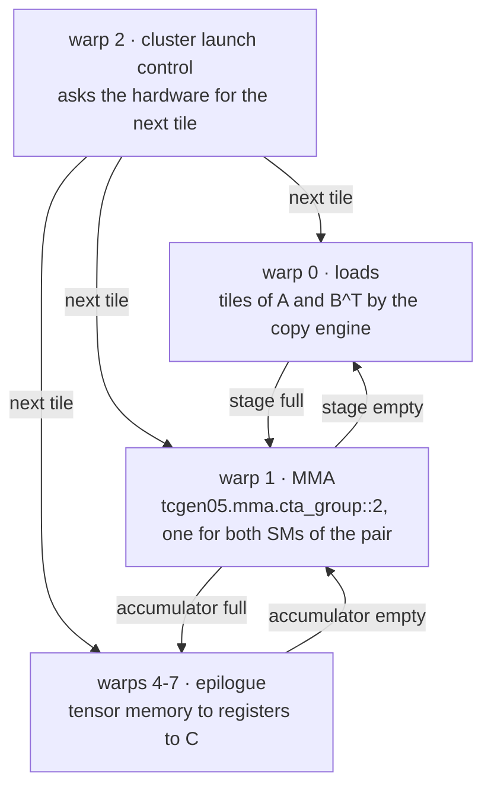
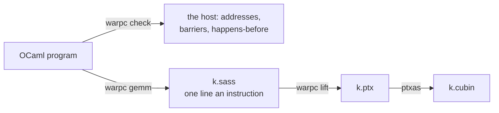

# SASS-Level Kernel Generation for Blackwell

warpc is a compiler for Blackwell tensor-core kernels, about ten thousand
lines of OCaml. On an NVIDIA B200, with every call run alone and nothing
overlapping on either side, its GEMMs are faster than cuBLAS 13.8 at five
of eleven standard shapes and within 0.6% of it at four more. NVIDIA's
public ptxas builds every one of them from the PTX warpc writes. Before any
of them ran on a GPU, warpc executed the SASS it writes for it on the CPU,
every instruction of every warp in the first and last clusters, and checked
each derived address against its layout, the protocol of each barrier, and
that every two accesses to one place, one of them a write, are ordered.

| 16% | 10% | 6% |
|:-:|:-:|:-:|
| faster than cuBLAS at 1024 cubed | faster than cuBLAS at 1024 x 1024 x 65536 | faster than cuBLAS at 2048 x 2048 x 16384 |

This is how it works.

- [The numbers](#the-numbers)
- [What a Blackwell GEMM is](#what-a-blackwell-gemm-is)
- [Writing a kernel](#writing-a-kernel)
- [Addresses from layouts](#addresses-from-layouts)
- [The host checker](#the-host-checker)
- [From the program to the GPU](#from-the-program-to-the-gpu)
- [Inside the kernels](#inside-the-kernels)
- [How we measured](#how-we-measured)
- [Try it](#try-it)

## The numbers

One B200, fp16 in, fp32 out, C = A B^T. Each call runs alone: the next is
launched only once it has finished, on both sides, so no two calls overlap.
A time is the GPU time of one call in microseconds, from its kernel's
start to its end ([How we measured](#how-we-measured)). cuBLAS is cuBLASLt
13.8 on the fastest exact algorithm its heuristic returns, reading the same
matrices.

| M x N x K | warpc | cuBLAS 13.8 | warpc faster by |
|---|--:|--:|--:|
| 1024 x 1024 x 1024 | 4.64 - 4.67 | 5.41 - 5.44 | **+16.2%** |
| 1536 x 1536 x 1536 | 7.87 | 7.84 - 7.87 | -0.4% |
| 2048 x 2048 x 2048 | 14.46 | 13.79 - 13.82 | -4.6% |
| 3072 x 1280 x 2048 | 14.08 | 13.57 - 13.60 | -3.6% |
| 4096 x 4096 x 1024 | 26.11 | 26.85 - 26.94 | **+2.8%** |
| 4096 x 4096 x 4096 | 75.78 - 75.97 | 75.55 - 75.65 | -0.4% |
| 8192 x 2048 x 4096 | 75.84 - 75.97 | 75.87 - 76.03 | 0.0% |
| 8192 x 8192 x 8192 | 553.1 - 554.3 | 557.6 - 558.0 | **+0.7%** |
| 16384 x 16384 x 16384 | 4132.8 - 4239.4 | 4159.7 - 4404.7 | -0.6% |
| 2048 x 2048 x 16384 | 73.92 - 74.11 | 78.43 - 78.62 | **+6.0%** |
| 1024 x 1024 x 65536 | 76.93 - 77.22 | 84.96 - 85.31 | **+10.2%** |

"warpc faster by" takes cuBLAS's fastest run against the midpoint of
warpc's range. At 1024 cubed, +16.2% means cuBLAS's fastest run takes
16.2% longer a call than the midpoint of warpc's.

**Long, thin problems are decided by how K is split.** 1024 x 1024 x 65536
has only eight output tiles for 74 pairs of SMs. warpc splits K nine ways,
so 72 pairs work at once, and every run adds its partial sum into C in the
L2 with the copy engine's reduce-add (`cp.reduce.async.bulk.tensor` with
`.add`), once the tile's runs have zeroed it. At 2048 x 2048 x 16384 warpc
runs stream-K over all 74 pairs: the CTA holding a tile's first k step
stores it, and the tile's other CTAs add to it in the L2.

**Large problems are decided by the tensor core.** From 8192 cubed up each
CTA computes a 256 x 256 tile, two pair MMAs of M = 256 stacked, taking
tiles by cluster launch control in a serpentine order.

## What a Blackwell GEMM is

A Blackwell GEMM kernel is not a loop nest. One CTA runs a warp that loads
tiles of A and B with the copy engine, a warp that issues tensor-core MMAs,
four warps that move the result out of tensor memory, and, in the
kernels that take tiles by cluster launch control, a warp that asks the
hardware scheduler for the next tile. The MMA spans two CTAs on two SMs (`cta_group::2`), so half of every
operand and half of every accumulator lives in another SM's memory. The
warps hand work to one another through mbarriers in shared memory, each
with a phase, an expected byte count and an arrival count. The copy engine
and the tensor core run asynchronously and report back through those same
barriers.

Every stage of the main loop has four addresses to get right, and every
handoff has a protocol. When a barrier is used out of order, or an address
is wrong but still inside its buffer, the GPU doesn't stop with an error.
The kernel hangs, or it computes a wrong tile.

warpc's answer is to make the program explicit and the compiler strict.
The program states its own instructions. The compiler adds the shared- and
global-memory address arithmetic, derived from layouts, and the
bookkeeping of loops, rings and waits, and it checks the barriers and the
order of memory accesses on the host before the GPU sees the kernel.

## Writing a kernel

All the GEMMs in the table are one OCaml program,
`backend/gemm_swapped.ml`, configured per shape. Its warps take these
roles:



Each arrow is a pipe (`backend/pipe.ml`): a ring of stages, each with a
full barrier and an empty barrier. The producer's end and the consumer's
end of a pipe are different OCaml types. A producer can only wait for a
stage to be empty and fill it, and a consumer can only wait for it to be
full and free it.

Here is the tensor-core warp of the 256 x 256 GEMM. It names two rings of
operand tiles and the pipe that hands their stages over:

```ocaml
let sa = Mem.ring km ~name:"sa" ~depth ~elem l_sa in       (* A's tiles *)
let sb = Mem.ring km ~name:"sbt" ~depth ~elem l_sb in      (* B^T's *)
let stages = Pipe.make km ~name:"stage" ~depth ~fills:1 ~frees:cluster_n in
```

and, with `inp` this warp's end of the pipe, one stage of its k loop is

```ocaml
k_loop (fun kk ->
  Pipe.consume inp (fun () ->
    Prog.emit p (uisetp_ne accum first);
    if ask_ahead then Prog.emit p (bra probe landed);
    Pipe.wait_full inp;
    Prog.label p landed;
    for r = 0 to reps - 1 do                  (* two stacked M = 256 atoms *)
      for j = 0 to (tile_k / mk) - 1 do
        Mem.mma km ~leader regs ~a:(Mem.sub (Pipe.slot_c inp sb) (r * a_rows, j * mk))
          ~b:(Mem.sub (Pipe.slot_c inp sa) (0, j * mk)) ~d:(acc, r * span)
          ~accumulate:(if j = 0 then `If accum else `Always)
      done
    done;
    Prog.emit p (umov first 1);
    Mem.commit2_mc km ~leader (Pipe.empty inp) ~mask:mask_all);
  if ask_ahead then Prog.when_ p more (fun () -> Pipe.probe_full inp ~into:probe))
```

Every instruction of the loop comes from a line of this code, except the
address arithmetic the compiler derives and the bookkeeping of the loop,
the ring and the waits. The MMA's operands are sub-tiles of
whatever stage the pipe holds, and there is no address anywhere in the
code. `warpc expand` prints what the compiler makes of it, one line an
instruction. Lines marked `+` are addresses the compiler derived, lines
marked `~` belong to the loop and the ring, and unmarked lines are the
program's own:

```
LOOP_3:
~ IADD3 k, PT, PT, k, 0x1, RZ
~ ISETP.LT.U32.AND more, PT, k, 0x80, PT
~ UISETP.NE.U32.AND stage_stays, UPT, stage_stage, 0x3, UPT
+ UIMAD bar@stage, stage_stage, 0x8, smem
+ UIMAD sbt_desc@stage, stage_stage, 0x800, sbt_desc_base
+ UIMAD sa_desc@stage, stage_stage, 0x400, sa_desc_base
+ UIMAD stage_empty@stage, stage_stage, 0x8, stage_empty_base
  UISETP.NE.U32.AND accumulate, UPT, first, URZ, UPT
  @probe BRA READY_1
WAIT_5:
  SYNCS.PHASECHK.TRANS64.TRYWAIT waited, [bar@stage], stage_parity
~ @!waited NANOSLEEP.SYNCS 0xc350
~ @!waited BRA WAIT_5
READY_1:
+ UIADD3 desc_b0.0, UPT, UPT, sa_desc@stage, 0x0, URZ
+ UIADD3 desc_a0.0, UPT, UPT, sbt_desc@stage, 0x0, URZ
  @leader UTCHMMA.2CTA gdesc[desc_a0.0], gdesc[desc_b0.0], tmem[acc], tmem[zero_idesc.0], idesc[zero_idesc.1], accumulate
  ... seven more MMAs, the k steps alternating between two descriptor pairs;
      the second atom's at sbt_desc@stage + 0x400, into acc_col = acc + 0x100
  UMOV first, 0x1
  @leader UTCBAR.2CTA.MULTICAST [stage_empty@stage], URZ, mask
~ PLOP3.LUT stage_stays_p, PT, PT, PT, stage_stays, 0x80, 0x8
~ @stage_stays UIADD3 stage_stage, UPT, UPT, stage_stage, 0x1, URZ
~ @!stage_stays UIADD3 stage_stage, UPT, UPT, stage_stage, -0x3, URZ
~ @!stage_stays_p LOP3.LUT stage_parity, stage_parity, 0x80000000, RZ, 0x3c, !PT
+ UIMAD bar@stage, stage_stage, 0x8, smem
  @more SYNCS.PHASECHK.TRANS64.TRYWAIT probe, [bar@stage], stage_parity
~ @more BRA LOOP_3
```

Each of the stage's four addresses is one multiply-add, placed where the
stage is first asked about. The waits on the stage's full and empty
barriers share one address (`bar@stage`) and name their array by an
immediate offset, as the loading warp's wait on `[bar@stage+0x20]` does.
The commit that frees the stage has its own (`stage_empty@stage`). In the
SASS warpc writes, the loop is 45 instructions.

Registers are declared by name and coloured by liveness. When they don't
fit, warpc stops and names the point of greatest pressure and what is live
there. The SASS warpc writes never spills. In the build that runs, ptxas
allocates the registers again from the PTX.

## Addresses from layouts

A layout maps the coordinates of a tile to integers. In warpc's algebra
every layout names the space it maps between: a logical index, a
thread-value index, or a physical offset. A layout into logical or
thread-value space is a bijection onto its range. A layout into physical
space keeps different coordinates on different addresses, except where it
marks a broadcast. Composing two layouts needs only that the inner one land
exactly on the outer one's coordinates. Whether the composite is itself a
strided layout, perhaps over a finer shape, is decided afterwards. When it
is, the strided form is unique, and that form is what warpc emits.

The tests (`dune test`) measure how often the decision procedure pays
off. Of the 178 layouts the tests build from
CUTLASS's atoms and CuTe's examples, 147 are affine in their coordinates, 9
are layouts of a refinement with one coordinate split, and 22 are emitted
as composites. On 600 random composites of a dense bijection with a padded
storage map, 524 are layouts of some refinement, and their emitted forms
contain 686 divisions and moduli where the composites contain 1,026.

In warpc a buffer is declared with its layout: a ring of 128-byte-swizzled
operand tiles, a row of staging copies a warp, an array of barriers, a
workspace in global memory. An operand is a buffer at coordinates, and its
address is the buffer's layout at those coordinates, composed with the
instruction's own fragment where its lanes differ. The compiler derives the
strided form over the program's indices into holes the program leaves as it
is built. A value of fixed indices is set once, where the last of them is
fixed. A value affine in a loop counter becomes an induction, set where the
loop starts and stepped where it steps. A value of a ring position is one
multiply-add at the top of each iteration, ahead of the wait.

The instructions' layouts are values of the same algebra
(`backend/atom.ml`). The MMA is CuTe's `SM100_MMA_F16BF16_SS` and
`_2x1SM_SS`, with CuTe's A, B and C thread-value layouts. The UMMA
shared-memory descriptor, the 32-bit instruction descriptor, the
tensor-memory accumulator, the `tcgen05.ld.32x32b` fragment and each tensor
map's box are read off layouts. Take a stage of A, 128 rows of 64 fp16 values,
K-major, with the 128-byte swizzle. Its descriptor's high word comes out as
`0x40004040`: the stride of one 8-row group (1024 bytes, shifted right by
4) in bits 32-45, the fixed `0b001` in bits 46-48, and swizzle mode 2 in
bits 61-63, exactly as the PTX ISA lays out the fields. Each encoding has a
decider that rebuilds the image the encoding describes and compares it with
the layout at every coordinate, so a layout an instruction cannot express
is refused when the kernel is built.

The host side reads the same layouts. A kernel's header names each tensor
map by the box its layout fixes:

```
.kernel swapped_2048_2048_2048_128x128_s8
.sm sm_100a
.threads 256
.dynsmem 204800
.tmap c 2048 2048 4 8 32 128
.tmap a 2048 2048 2 64 64 128
.tmap bt 2048 2048 2 128 64 128
.grid 148 1
.mbarriers 20
.cluster 2
```

`backend/node/run_tma.py` encodes the tensor maps from those lines, so the
host cannot disagree with the addresses the kernel computes.

## The host checker

`warpc check` runs the kernel on the CPU (`backend/interp.ml`), as the
SASS text warpc writes, before the lift to PTX and before ptxas schedules
it and allocates its registers. It runs every warp of the first and last
clusters, lanes together as a warp runs
them, with the barriers, the copy engine, the tensor core and the hardware
scheduler modelled by what each instruction does to its operands. An
mbarrier counts its phase's arrivals and bytes. A copy-engine load lands
its bytes in each CTA it multicasts to. A wait passes once the phase of its
parity has completed. The matrix values themselves are checked on the GPU,
against numpy. On the GEMM warpc picks for 4096 cubed:

```
$ warpc check gemm 4096 4096 4096
338986 derived operands checked, 0 wrong, 0 changed by the colouring; 0 named-barrier arrivals that do not make their counts; 0 protocol problems; 0 uses of memory past what was declared; 0 accesses nothing orders
```

**Every derived operand against its layout.** The reference comes from the
buffer's layout at the coordinates, not from the expression the compiler
derived. The register-coloured program has to produce the same values as
the program written with names.

**The barriers' protocol.** Every warp must leave. A warp still waiting is
a hang, reported with what it waits for and where the barrier stands. Drop
one producer's arrival from a GEMM and the checker says

```
hang: CTA 3 warp 5 waits on stage_full[0] for the phase of parity 0: it is in phase 0, 1 of 1 arrivals to come, -32768 bytes
```

**The happens-before order.** Each warp, each tensor core's queue of MMAs
and commits, and each copy-engine transfer keeps a vector clock, and a
barrier's phase hands the clocks of what arrived to whatever waits on it.
Two accesses to one place in shared, global or tensor memory, one of them a
write, must be ordered. Move a stage's release ahead of the MMAs that read
it and the checker says

```
sbt[0]: UTCHMMA, warp 5 reads it and UTMALDG.2D, warp 4 writes it, and nothing orders the two
```

A write through the generic proxy must be fenced before the copy engine or
the tensor core reads it, and a global write another CTA reads must be
fenced at GPU scope. `warpc hb` prints what orders what, for every buffer
and every kind of ordered pair of accesses, with how many pairs it saw. An
excerpt for 1024 cubed:

```
buffer         earlier                                         later                                         ordered by
sa             UTMALDG.2D.2CTA, warp 0                         UTCHMMA.2CTA, warp 1 of another CTA           wait on stage_full  (128)
sa             UTCHMMA.2CTA, warp 1 of another CTA             UTMALDG.2D.2CTA, warp 0                       wait on stage_empty  (24)
tensor memory  UTCATOMSWS.2CTA.FIND_AND_SET.ALIGN, warp 1      UTCHMMA.2CTA, warp 1 of another CTA           cluster barrier  (2)
tensor memory  UTCHMMA.2CTA, warp 1                            LDTM.x32, warps 4-7                           wait on acc_full  (16)
tensor memory  LDTM.x32, warps 4-7                             UTCATOMSWS.AND, warp 1                        wait on acc_empty  (16)
tmem_word      STS, warp 1                                     LDS, warps 4-7                                cluster barrier  (16)
```

The second row is the ordering a stage freed too early breaks: the copy
engine may refill a stage only after the other SM's MMAs have read it.

**Memory as declared.** Every access lands inside a buffer the kernel
declares. Tensor memory keeps each column's state, so an MMA that adds to
an accumulator adds to one an MMA has written, and a load reads what an MMA
wrote.

The 11 programs `warpc gemm` chooses for these shapes on the B200 have
between 87 thousand and 37 million checked operands each.
Every one of them passes every check.

OCaml's types refuse a further class of mistakes before any of this runs.
Registers, buffers and indices carry their kinds in their types, and
`backend/typing/` holds programs that must fail to compile:

```ocaml
(* a wait on an operand tile, not a barrier *)
let () = Mem.wait km (Mem.at sa [ C 0 ]) ~parity:(Core.r "parity")
(* Type Mem.tile = [ `Tile ] is not compatible with type Mem.barrier = [ `Barrier ] *)

(* a counter stepped as a ring *)
let () = Prog.for_ p ~name:"k" ~count:(Times 2) (fun kk -> Prog.step p kk ignore)
(* Type Prog.counter = [ `Counter ] is not compatible with type Prog.ring = [ `Ring ] *)

(* a uniform register where a general one belongs *)
let _ = Core.iadd3 (Core.r "a") (Core.ur "u") (Core.r "b")
(* Type Core.ur = [ `UR ] is not compatible with type Core.r = [ `R ] *)
```

The types erase. They add no instruction to the kernel.

## From the program to the GPU



`warpc gemm` prints the kernel as SASS text, one instruction a statement,
in program order. `warpc lift` writes each instruction as the PTX that asks
for the same work. Here is one MMA of the 2048-cubed kernel's main loop on
each side:

```
  UIADD3 UR18, UPT, UPT, UR32, 0x0, URZ
  UIADD3 UR16, UPT, UPT, UR31, 0x0, URZ
  @UP0 UTCHMMA.2CTA gdesc[UR16], gdesc[UR18], tmem[UR29], tmem[UR14], idesc[UR15], UP3
```

```
	add.u32 %v87, %v85, 0;
	add.u32 %v88, %v84, 0;
	mov.b64 %d6, {%v88, %v68};
	mov.b64 %d7, {%v87, %v69};
	@!%c2 bra LIFT_SKIP_1;
	@%pe tcgen05.mma.cta_group::2.kind::f16 [%v80], %d6, %d7, %v67, %c21;
LIFT_SKIP_1:
```

ptxas then schedules the PTX, allocates its registers and encodes it.
There are a few places where the two sides differ:
- The single-issue instructions (MMA, commit, copy-engine load and store)
  run on the lane `elect.sync` picks at the kernel's entry, and a uniform
  guard on one becomes a branch around it.
- The tensor-memory allocation becomes one `tcgen05.alloc`.
- A try-wait's sleep becomes the try-wait's suspend-time hint.
- PREEXIT and ACQBULK become `griddepcontrol.launch_dependents` and
  `griddepcontrol.wait`.

PTX allows one `.cta_group` in a kernel, so a program that issues pair MMAs
allocates, relinquishes and frees its tensor memory for the pair, and the
lifter refuses a kernel that names both groups.

The ptxas is the one PyPI ships as `nvidia-cuda-nvcc` (13.4), and every
opcode the programs use is one that ptxas itself emits. Everything between
the OCaml program and the cubin is in this repository or is that ptxas.

## Inside the kernels

`warpc gemm` picks a program by a rule over the shape
(`backend/programs.ml`). The ring depth is how many stages of A and B
tiles are in flight at once. On the B200:

| M x N x K | program |
|---|---|
| 1024 x 1024 x 1024 | 128 x 64 a CTA, ring depth 13, asking a stage ahead, stored from the registers |
| 1536 x 1536 x 1536 | 128 x 128 a CTA, ring depth 6, stored from the registers, the next grid let in after the last load |
| 2048 x 2048 x 2048 | 128 x 128 a CTA, ring depth 8, 2 accumulators, a fixed grid of 148 CTAs walking the tiles by stride, in groups of 16 |
| 3072 x 1280 x 2048 | 128 x 128 a CTA, ring depth 8, 2 x 4 clusters, 2 accumulators, cluster launch control, the next grid let in after the last load |
| 4096 x 4096 x 1024 | 256 x 128 a CTA, ring depth 5, 2 accumulators, the next grid let in after the last load |
| 4096 x 4096 x 4096 | 192 x 128 a CTA, ring depth 7, 2 accumulators, cluster launch control |
| 8192 x 2048 x 4096 | 192 x 128 a CTA, ring depth 7, 2 accumulators, cluster launch control |
| 8192 x 8192 x 8192 | 256 x 256 a CTA, ring depth 4, cluster launch control, asking a stage ahead |
| 16384 x 16384 x 16384 | 256 x 256 a CTA, ring depth 4, cluster launch control, asking a stage ahead |
| 2048 x 2048 x 16384 | 256 x 128 a CTA, ring depth 6, 2 accumulators, asking a stage ahead, stream-K adding in the L2 |
| 1024 x 1024 x 65536 | 256 x 256 a CTA, ring depth 4, asking a stage ahead, K split 9 ways over the grid, adding in the L2 |

**CTA pairs.** Every program issues `tcgen05.mma.cta_group::2`. One MMA of
M = 256 spans two SMs, and each CTA holds half of the accumulator in its
own tensor memory. The pair's leader issues the MMAs for both.

**A and B swapped in the MMA.** warpc feeds the tile of B^T as the MMA's
A operand and the tile of A as its B operand, so each CTA's accumulator is
its block of C transposed. CUTLASS calls this SwapAB. The pair's 256-row
MMA then runs along the columns of C.

**Multicast clusters.** In a 2 x 2 or 2 x 4 cluster, the pairs that cover
the same columns of C share the tile of B^T. Each CTA loads a slice of it
and multicasts it to the others.

**Cluster launch control.** A CTA that finishes a tile takes the next one
by cancelling a cluster the hardware has not launched yet
(`clusterlaunchcontrol.try_cancel`). A dedicated warp asks, and every role
reads the answer from a pipe.

**Two accumulators** in tensor memory. The tensor core fills one tile's
accumulator while the four storing warps empty the other.

**Asking a stage ahead.** As soon as it has issued a stage's MMAs, the
tensor-core warp tests the next stage's barrier, and it skips the wait when
that stage has already landed.

**Stream-K and split-K, added in the L2.** Where tiles do not fill the
machine, K is split across CTAs, and the partial sums meet in C through the
copy engine's reduce-add. In stream-K, the CTA holding a tile's first k
step stores it and raises the tile's flag, and the tile's other CTAs add to
it once the flag is up. In the split over the grid, the CTAs sharing a tile
zero it first and then each adds its whole partial. A flag holds one past what its
CTA's own word held, so no flag is ever reset between launches.

**Dependent launch.** Each kernel waits for the previous one just before
its first global memory access, and warpc refuses a kernel that reaches
global memory on any path without that wait. Most kernels let the next one
launch from their first instruction. In the programs that let the next
grid in after the last load, the loading warp gives that signal once it
has issued its last load.

## How we measured

- **Nothing overlaps.** Both sides run with `CUDA_LAUNCH_BLOCKING=1`, so
  every launch returns only once its kernel has finished, and warpc is
  launched without dependent launch. No call's kernel starts before the
  previous call's has ended.
- **GPU time from CUPTI.** `backend/node/ktrace.cpp`, loaded into either
  harness through `CUDA_INJECTION64_PATH`, records each kernel's start and
  end on the GPU. A call's time is the sum of its kernels' durations, the
  median over the last 400 calls (300 at 4096 x 4096 x 1024; 200 at 4096
  cubed, 8192 x 2048 x 4096, 2048 x 2048 x 16384 and 1024 x 1024 x 65536;
  40 at 8192 cubed; 12 at 16384 cubed).
- **The same inputs on both sides.** warpc and cuBLAS read the same
  matrices: integers in [-3, 3] from one hash of the index.
- **Interleaved, on one GPU.** Each shape runs as warpc, cuBLAS, cuBLAS,
  warpc, twice, all on the same B200, and the table gives each side's range
  over its four runs.
- **cuBLAS at its best.** cuBLASLt 13.8 (13.8.2.12) runs every algorithm its
  heuristic returns for the problem, and we keep the fastest that matches
  exactly.
- **Correct first.** Each warpc kernel is compared with numpy on its first
  launch and on its last of 20.

`backend/node/ab.py` times warpc kernels and `backend/node/cublas_q7.cpp`
times cuBLASLt, both on these inputs:

```sh
export CUDA_LAUNCH_BLOCKING=1 CUDA_INJECTION64_PATH=libktrace.so KT_LAST=400
AB_SERIES=1 python3 backend/node/ab.py 1 400 k.cubin
CQ_NOBLOCK=1 ./cublas_q7 2048 2048 2048 400 ALGO
```

## Try it

warpc needs OCaml 5 and dune 3 with the `base`, `sexplib0` and `stdio`
libraries (`opam install dune base stdio`). Running a kernel needs a B200,
ptxas (`pip install nvidia-cuda-nvcc`) and numpy.

```sh
dune build && dune test
./_build/default/backend/warpc.exe gemm 4096 4096 4096 > k.sass
./_build/default/backend/warpc.exe check gemm 4096 4096 4096
./_build/default/backend/warpc.exe hb gemm 4096 4096 4096
./_build/default/backend/warpc.exe lift k.sass > k.ptx
ptxas -arch=sm_100a k.ptx -o k.cubin
python3 backend/node/run_tma.py k.sass k.cubin
```

`run_tma.py` encodes the tensor maps from the kernel's header, launches the
cubin, checks it against numpy and times it. `warpc --sm sm_103a` builds
for the B300. ptxas 12.9 or later builds every program.
[`docs/warpc.md`](docs/warpc.md) is the full reference: the language, the
checks, the lifter, and every program's options.

## Repository

    lib/              the layout algebra: shapes, strides and replication,
                      swizzles, composition, the decision procedure, emission
    backend/          warpc
      core, prog      the language: statements, registers, indices, constructs
      mem, pipe       buffers declared with layouts; pipes between warps
      atom, store     the instructions' layouts; the accumulator's way out
      color           register colouring, an error rather than a spill
      interp          the host-side checker
      lift            SASS text to PTX
      gemm_one, gemm_pair, gemm_swapped, programs
                      the GEMMs, and the rule that picks one for a shape
      typing/         programs the types refuse
      node/           launching, checking and timing on the GPU
    test/             the algebra against enumeration, CuTe's documented
                      examples, and a table of layouts in use
    docs/warpc.md     the full reference
